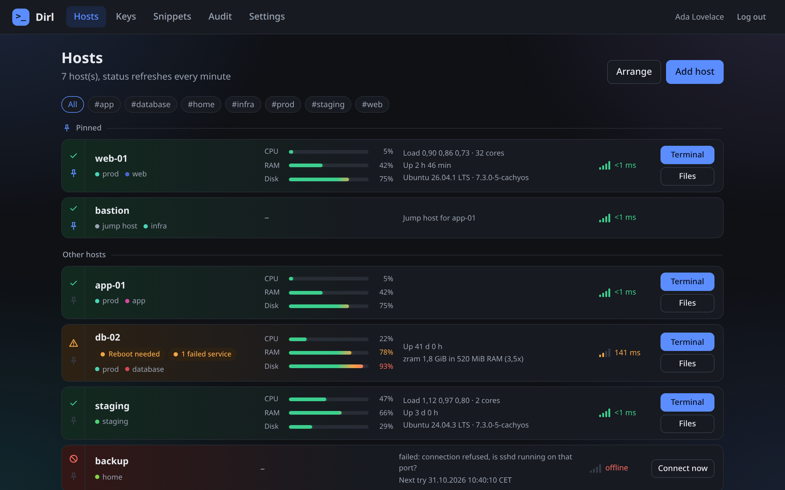
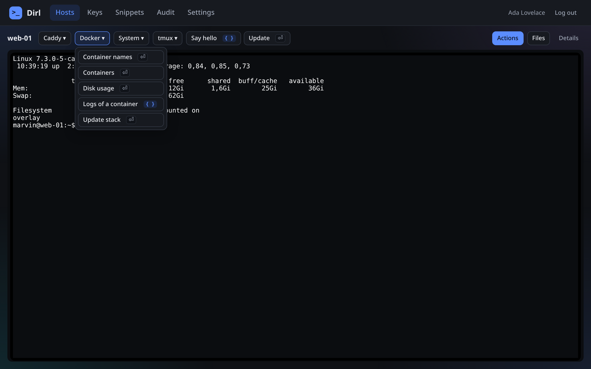
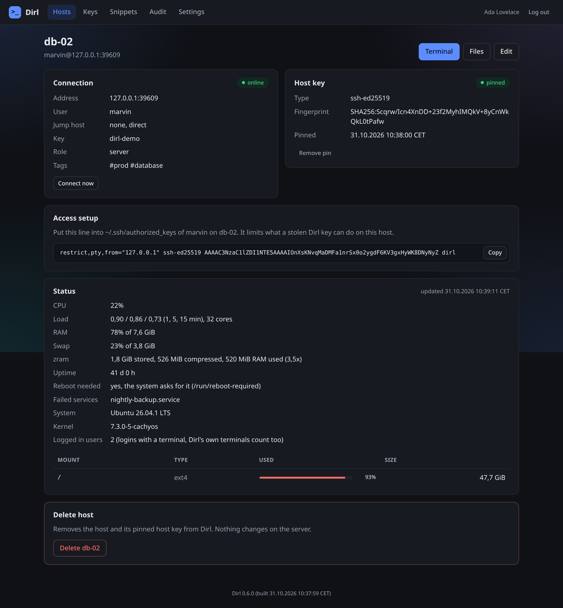
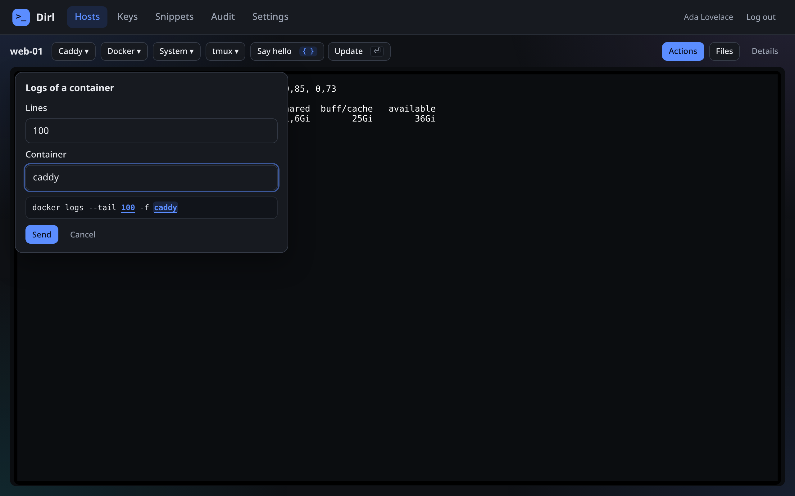
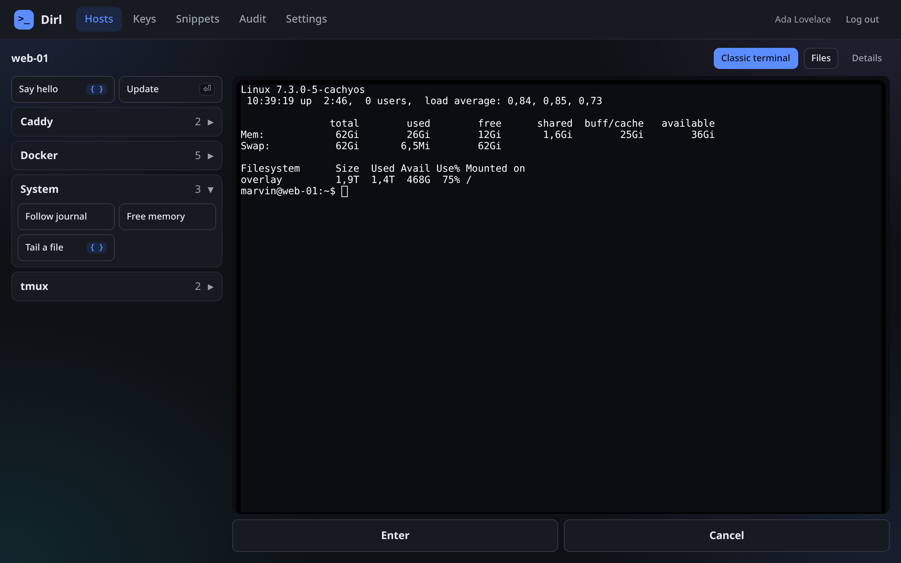

# Dirl

[](https://github.com/nexus421/Dirl/actions/workflows/build.yml)


A lean, self-hosted web SSH client. Terminal, SFTP, jump hosts and server status in your browser, shipped as one
Kotlin fat JAR with login through any OpenID Connect provider and an encrypted vault for hosts and keys. Small enough
to review alone, managed entirely in the UI.



| Terminal | Host details |
|---|---|
|  |  |
| **Snippet with variables** | **Actions mode** |
|  |  |

## Features

- Browser terminal (xterm.js) with resize and snippets: folders, variables like `{{Container}}` asked for before
  sending, import and export as JSON
- Actions mode for phones: snippets, Enter and Cancel instead of the keyboard, tmux snippets for long jobs
- Installable as an app, without a service worker or any cache
- SFTP file manager with upload, rename and download
- Up to two jump hosts, with restricted `authorized_keys` lines generated for every host
- Host key pinning (trust on first use), hard block on changes
- Status per host: reachability, SSH round trip, CPU, RAM, swap, disks, load, uptime, failed services, reboot
  needed, zram, system, each host chooses what its overview row shows
- Hosts pinned to the top and in your own order
- A note in the footer when a newer release is out, can be turned off
- SSH connections only while Dirl is open in a browser, nothing runs in the background
- Encrypted vault (AES-256-GCM, Argon2id), audit log, OIDC login with PKCE
- Users, sessions, keys and settings managed in the browser

## Quick start

Requires JDK 25 to build, Java 21 to run.

```bash
./gradlew build
```

```bash
cp config.example.json config.json
```

Set `publicUrl` and the `oidc` section in `config.json`, then:

```bash
java -jar build/libs/dirl.jar config=config.json
```

Open `publicUrl`, sign in and create the vault passphrase. The first user becomes the first allowed user, so do this
right after deployment, or limit it with `oidc.allowedSubjects`. Then generate a key, add a host, put the shown
`authorized_keys` line on the server and confirm its host key fingerprint.

Try it locally without an identity provider:

```bash
./gradlew devRun
```

There is no official Docker image. Dirl runs as a plain JAR with Java 21, see [Deployment](docs/deployment.md). A
maintained image is a welcome contribution.

## Documentation

- [Usage](docs/usage.md): what each page does
- [Configuration](docs/configuration.md): config file, command line, unlock modes, OIDC provider setup
- [Deployment](docs/deployment.md): systemd, Incus, reverse proxy, backups
- [Security](docs/security.md): vault, access control, SSH restrictions, web hardening
- [Development](docs/development.md): tests, dev server, dependencies, project layout, endpoints
- [Concept](termix-eigenbau-konzept.md) (German): design decisions and reasoning

## Why Dirl

Dirl does one thing: SSH access to your servers from the browser, for one person or a small team. It is reduced to
what that needs and aims to be simple, stable, secure and reliable. A feature has to earn its place, and the code
stays small enough to review alone.

It exists because tools like Termix grew too fast for my taste. Many features, many small bugs, a lot to trust.
Dirl follows KISS instead.

Dirl is written with AI. Code, tests and documentation were created with Claude by Anthropic, directed, tested and
spot-checked by me.

## License

[MIT](LICENSE), Copyright (c) 2026 Marvin Kickner. The vendored xterm.js under
`src/main/resources/static/vendor/xterm` keeps its own MIT license.
